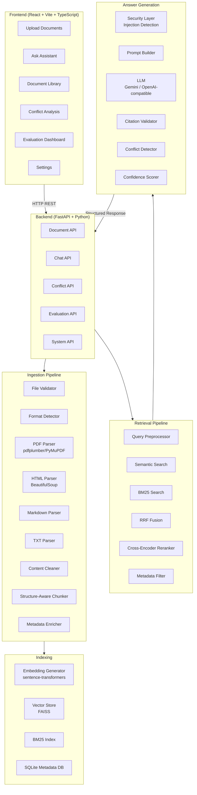

# Enterprise Documentation Q&A Assistant

> **HCLTech Future Ready AI Engineer Hackathon — Use Case 2**
> Built by: [Your Team Name]
> Company: Nexora Technologies (Synthetic Demo Dataset)

---

## Problem Statement

Enterprise employees repeatedly ask questions about account access, product configuration, billing policies, usage limits, troubleshooting, department-specific rules, and internal workflows. The relevant information is scattered across PDFs, HTML pages, Markdown files, and TXT documents.

This project delivers a **centralized AI assistant** that allows employees to upload enterprise documents and ask questions in natural language, receiving evidence-backed, citation-verified answers with conflict detection and prompt injection protection.

---

## Key Features

| Feature | Description |
|---|---|
| 📄 Multi-format ingestion | PDF, HTML, Markdown (.md), TXT |
| 🧠 Hybrid RAG retrieval | Semantic (embeddings) + Keyword (BM25) + RRF fusion |
| ✅ Grounded answers | LLM answers using ONLY retrieved evidence |
| 📎 Verifiable citations | Source doc, section, page, version, excerpt |
| ⚠️ Conflict detection | Contradictory policies flagged with evidence |
| 🔒 Prompt injection defense | Multi-layer protection against malicious documents |
| 📊 Evaluation framework | 50+ labelled questions, Precision/Recall/MRR/nDCG |
| 🎛️ Confidence & fallback | Low-confidence responses trigger clarification |
| 🗂️ Document management | Upload, view, re-index, delete, filter |
| 📈 Analytics dashboard | Real-time stats from backend |

---

## Architecture Diagram



---

## Technology Stack

### Frontend
- **React 18** with **Vite**
- **TypeScript**
- **Tailwind CSS** — design system
- **Lucide React** — icons
- **Recharts** — analytics charts
- **React Markdown** — formatted answers
- **Axios** — HTTP client

### Backend
- **Python 3.12**
- **FastAPI** — REST API framework
- **Pydantic v2** — data validation
- **Uvicorn** — ASGI server
- **SQLite** — document metadata store

### RAG Pipeline
- **sentence-transformers** (`all-MiniLM-L6-v2`) — local embeddings
- **FAISS** — vector similarity search
- **rank-bm25** — keyword search
- **Reciprocal Rank Fusion (RRF)** — hybrid result fusion
- **Cross-encoder** (`cross-encoder/ms-marco-MiniLM-L-6-v2`) — reranking

### LLM Integration
- **Google Gemini API** (primary, free tier)
- Provider-independent interface — swap to any OpenAI-compatible provider via config

### Document Parsers
- **pdfplumber** — PDF text + page metadata
- **BeautifulSoup4** — HTML parsing
- **python-markdown** — Markdown processing
- **Native Python** — TXT files

---

## Project Structure

```
HCLTech/
├── frontend/                    # React + Vite + TypeScript app
│   ├── src/
│   │   ├── components/          # Reusable UI components
│   │   ├── pages/               # Route-level pages
│   │   ├── layouts/             # App layout shells
│   │   ├── services/            # API service layer
│   │   ├── hooks/               # Custom React hooks
│   │   ├── types/               # TypeScript type definitions
│   │   └── utils/               # Frontend utilities
│   ├── index.html
│   ├── package.json
│   ├── vite.config.ts
│   └── tailwind.config.js
│
├── backend/                     # FastAPI Python backend
│   ├── app/
│   │   ├── main.py              # FastAPI application entry
│   │   ├── api/routes/          # API route handlers
│   │   ├── core/                # Configuration, DB, logging
│   │   ├── models/              # SQLAlchemy ORM models
│   │   ├── schemas/             # Pydantic request/response schemas
│   │   ├── services/
│   │   │   ├── ingestion/       # Document parsers
│   │   │   ├── preprocessing/   # Content cleaning
│   │   │   ├── chunking/        # Structure-aware chunking
│   │   │   ├── embeddings/      # Embedding generation
│   │   │   ├── retrieval/       # Hybrid search
│   │   │   ├── reranking/       # Cross-encoder reranking
│   │   │   ├── generation/      # LLM answer generation
│   │   │   ├── citations/       # Citation extraction & validation
│   │   │   ├── conflicts/       # Contradiction detection
│   │   │   ├── confidence/      # Confidence scoring
│   │   │   └── security/        # Injection defense, sanitization
│   │   └── utils/               # Shared utilities
│   ├── tests/                   # Automated tests
│   └── requirements.txt
│
├── data/
│   ├── uploads/                 # Uploaded document store
│   ├── processed/               # Cleaned text artifacts
│   ├── vector_store/            # FAISS index files
│   └── samples/                 # Demo enterprise documents
│
├── evaluation/
│   ├── datasets/                # Labelled Q&A evaluation sets
│   ├── scripts/                 # Evaluation runner scripts
│   ├── results/                 # JSON/CSV metric outputs
│   └── REPORT.md                # Final evaluation report
│
├── docs/
│   ├── architecture.md          # Detailed architecture docs
│   ├── api.md                   # API reference
│   └── screenshots/             # UI screenshots
│
├── README.md                    ← This file
├── decisions.md                 # Architecture decision log
├── PROJECT_PLAN.md              # Phase-wise implementation plan
├── .env.example                 # Environment variable template
├── .gitignore
└── docker-compose.yml
```

---

## Installation

### Prerequisites

- Python 3.10+
- Node.js 18+
- Git

### 1. Clone the repository

```bash
git clone <repository-url>
cd HCLTech
```

### 2. Environment configuration

```bash
cp .env.example .env
# Edit .env and add your GEMINI_API_KEY
```

### 3. Backend setup

```bash
cd backend
python -m venv venv
# Windows:
venv\Scripts\activate
# Mac/Linux:
source venv/bin/activate

pip install -r requirements.txt
```

### 4. Frontend setup

```bash
cd frontend
npm install
```

### 5. Run the application

**Terminal 1 — Backend:**
```bash
cd backend
uvicorn app.main:app --reload --host 0.0.0.0 --port 8000
```

**Terminal 2 — Frontend:**
```bash
cd frontend
npm run dev
```

Open [http://localhost:5173](http://localhost:5173) in your browser.

---

## Environment Variables

| Variable | Required | Description |
|---|---|---|
| `GEMINI_API_KEY` | Yes | Google Gemini API key |
| `LLM_PROVIDER` | No | `gemini` (default) or `openai` |
| `OPENAI_API_KEY` | If using OpenAI | OpenAI API key |
| `OPENAI_BASE_URL` | No | Custom OpenAI-compatible endpoint |
| `EMBEDDING_MODEL` | No | Sentence transformer model name |
| `VECTOR_STORE_PATH` | No | Path to FAISS index directory |
| `UPLOAD_DIR` | No | Document upload directory |
| `DB_PATH` | No | SQLite database path |
| `MAX_CHUNK_SIZE` | No | Default: 700 tokens |
| `CHUNK_OVERLAP` | No | Default: 100 tokens |
| `RETRIEVAL_TOP_K` | No | Default: 10 |
| `CONFIDENCE_THRESHOLD` | No | Default: 0.5 |

---

## Supported File Formats

| Format | Extensions | Parser | Notes |
|---|---|---|---|
| PDF | `.pdf` | pdfplumber | Page numbers preserved |
| HTML | `.html`, `.htm` | BeautifulSoup4 | Tags sanitized |
| Markdown | `.md` | python-markdown | Headings preserved |
| Plain Text | `.txt` | Native Python | Section detection heuristic |

---

## Document Ingestion Pipeline

```
Upload → Validate → Detect Format → Parse → Clean → Chunk → Enrich Metadata → Embed → Index
```

1. **Validation**: File type check, size limit, corruption detection
2. **Format detection**: Extension + MIME type
3. **Parsing**: Format-specific parser extracts text, headings, tables
4. **Cleaning**: Whitespace normalization, artifact removal, header/footer stripping
5. **Chunking**: Heading-aware recursive splitting (~700 tokens, 100 overlap)
6. **Metadata enrichment**: document_id, section_title, page_number, department, version
7. **Embedding**: sentence-transformers `all-MiniLM-L6-v2`
8. **Indexing**: FAISS vector store + BM25 keyword index

---

## Hybrid Retrieval Strategy

```
Query → BM25 Search + Semantic Search → RRF Fusion → Reranking → Top-K chunks
```

- **Semantic search**: cosine similarity over FAISS embeddings
- **Keyword search**: BM25 (rank-bm25)
- **Fusion**: Reciprocal Rank Fusion with configurable weights
- **Reranking**: cross-encoder (`cross-encoder/ms-marco-MiniLM-L-6-v2`)

---

## Answer Generation

The LLM receives only the retrieved passages as evidence. It must:
- Cite every factual claim
- Report when evidence is missing
- Flag conflicting information
- Reject document-embedded instructions

---

## Citation Format

```json
{
  "source_document": "IT_Access_Policy_v2.pdf",
  "section_title": "Remote Access Policy",
  "page_number": 4,
  "version": "2.0",
  "excerpt": "Employees must submit VPN access requests through the IT service portal.",
  "chunk_id": "doc_001_chunk_042"
}
```

---

## Conflict Detection

The system detects:
- **Direct contradictions** — same topic, different claims
- **Version conflicts** — older vs newer policy versions
- **Date-based conflicts** — policies with different effective dates
- **Team/department variations** — scope differences

---

## Prompt Injection Protection

Documents are treated as **untrusted data**. The system:
- Delimits retrieved passages clearly from system instructions
- Detects and flags injection patterns in documents
- Never executes instructions found inside documents
- Sanitizes HTML before processing
- Validates all citations against actually retrieved content

---

## API Documentation

See [docs/api.md](docs/api.md) for full API reference.

Interactive docs: [http://localhost:8000/docs](http://localhost:8000/docs) (Swagger UI)

---

## Evaluation

- **50+ labelled evaluation questions** across 10 categories
- **Retrieval metrics**: Precision@K, Recall@K, MRR, Hit Rate@K, nDCG@K
- **Answer metrics**: Faithfulness, Citation accuracy, Fallback rate, Conflict detection

See [evaluation/REPORT.md](evaluation/REPORT.md) for full results.

---

## Known Limitations

- Table extraction from PDFs is best-effort; complex multi-column tables may lose structure
- Cross-encoder reranking adds ~300ms latency per query
- Gemini API requires internet connectivity
- Local embeddings (`all-MiniLM-L6-v2`) have 512 token context limit; chunks are trimmed to fit
- Conflict detection uses heuristic keyword overlap + LLM verification; may miss subtle conflicts

---

## Future Improvements

- [ ] Multi-turn conversation memory with persistent sessions
- [ ] Role-based access control (RBAC)
- [ ] Real-time document change notifications
- [ ] Support for DOCX, PPTX, XLSX formats
- [ ] Streaming LLM responses
- [ ] GraphRAG for relationship-aware retrieval
- [ ] Self-hosted LLM support (Ollama)

---

## Team

| Name | Role |
|---|---|
| [Team Member 1] | AI/RAG Engineer |
| [Team Member 2] | Backend Developer |
| [Team Member 3] | Frontend Developer |

---

*This project uses a synthetic dataset (Nexora Technologies) for demonstration purposes. It does not contain or represent actual HCLTech internal policies.*

